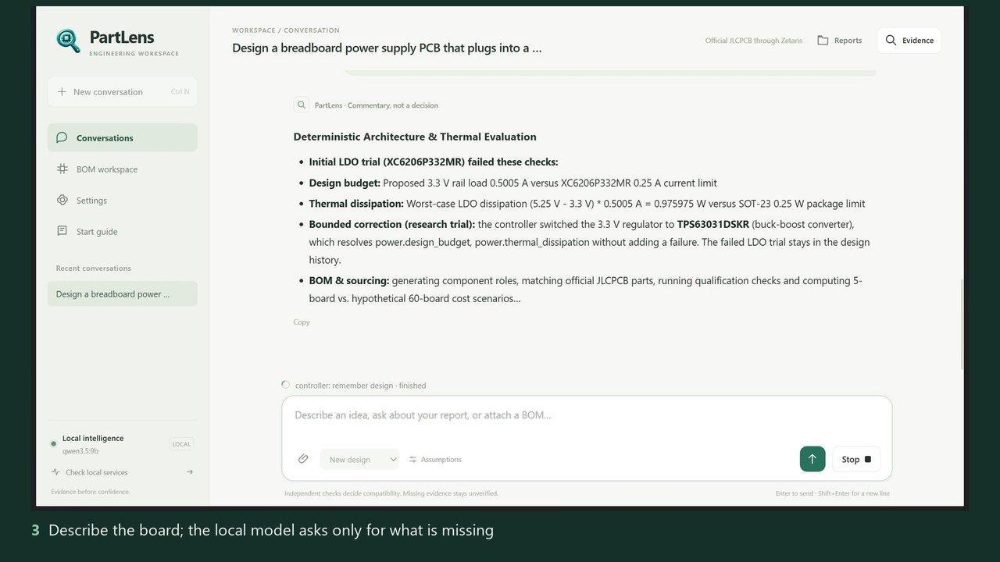
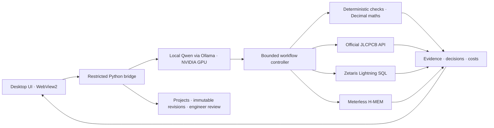

<p align="center">
  
</p>

<h1 align="center">PartLens</h1>

<p align="center"><strong>Evidence before confidence.</strong></p>

<p align="center">
  <a href="https://github.com/zgeez/PartLens/releases/latest/download/PartLens-demo.mp4">Watch the video</a> ·
  <a href="#quickstart-judges">Try it</a> ·
  <a href="docs/PartLens-deck.pdf">Slide deck</a> ·
  <a href="#sponsor-technology">Sponsor technology</a> ·
  <a href="docs/START-GUIDE.md">Start guide</a>
</p>

<p align="center">
  <a href="https://github.com/zgeez/PartLens/releases/latest/download/PartLens-demo.mp4"></a>
</p>

<p align="center"><a href="https://github.com/zgeez/PartLens/releases/latest/download/PartLens-demo.mp4"><strong>Watch the demo (2:32)</strong></a></p>

A cheaper or substitute part can still break a board: its voltage, current, thermal limit or package has to fit
the exact circuit, and chat assistants sound sure even when that evidence is missing.

**PartLens is a Windows desktop app that designs small electronics boards from an idea and reviews bills of
materials.** A local AI model investigates; deterministic engineering checks decide compatibility. Missing
evidence stays **unverified**, never a quiet yes.

| | |
|---|---|
| **Event** | Open Agent Hackathon 2026, 22–27 October 2026 |
| **Track** | Track 02 |
| **Team** | Cirquill (Ziad Ghanem) |
| **Status** | Hackathon submission. Designs are preliminary and labelled as such; nothing is marked working that you can't run. |
| **Video** | [PartLens-demo.mp4](https://github.com/zgeez/PartLens/releases/latest/download/PartLens-demo.mp4) (2:32, 1080p, narrated): a live run of the breadboard power supply design with the local model, official JLCPCB, Zetaris and Meterless H-MEM. Narration is Windows text-to-speech. |
| **Deck** | [docs/PartLens-deck.pdf](docs/PartLens-deck.pdf) (10 slides): problem, workflows, architecture, live demo, Zetaris, Meterless, NVIDIA, trust rules, limits |
| **Download** | [PartLens.exe](https://github.com/zgeez/PartLens/releases/latest/download/PartLens.exe) from the [latest release](https://github.com/zgeez/PartLens/releases/latest) (Windows x64, single file, 50 MB) |
| **Licence** | [Apache-2.0](LICENSE) |

[Quickstart (judges)](#quickstart-judges) · [What it does](#what-it-does) ·
[Sponsor technology](#sponsor-technology) · [Pre-existing components](#pre-existing-components) ·
[Where to look](#where-to-look-judging-criteria--repository)

## Quickstart (judges)

**Option A — the app (no install).** Download
[`PartLens.exe`](https://github.com/zgeez/PartLens/releases/latest/download/PartLens.exe) and double-click it. It needs the Windows
WebView2 Runtime (present on Windows 11). On first launch, **Add your API keys** asks for your own JLCPCB and
optional Zetaris keys; **Skip for now** runs with clearly labelled synthetic data. A guided tour follows.
For the AI features install [Ollama](https://ollama.com) and run `ollama pull qwen3.5:9b`.

**Option B — keyless check from source (about 2 minutes, no keys, no model, no network).** From CMD:

```cmd
python -m venv .venv
.venv\Scripts\python.exe -m pip install -e ".[dev]"
.venv\Scripts\python.exe -X utf8 scripts\sample_demo.py
```

Expected output: the banner `SYNTHETIC DETERMINISTIC SAMPLE`, then three candidate decisions for BOM line L1 —
`Equivalence: verified`, `Equivalence: rejected` and `Equivalence: unverified` (the last because the candidate
does not state its dielectric or temperature range) — followed by 7 unresolved inputs, such as the build
quantity and L4's missing part identity. Every check prints the supplier record it relied on.

Full test suite: `.venv\Scripts\python.exe scripts\validate.py` (392 tests; the H-MEM tests need the bridge
from [DEVELOPMENT.md](DEVELOPMENT.md)).

## What it does

- **New design from an idea.** Describe the board. PartLens asks only for missing requirements: your typed
  words confirm a requirement, while values the AI proposes stay *provisional*. It picks a reference
  architecture, runs deterministic checks, swaps out parts that fail and keeps every failed attempt on record.
- **Existing BOM review.** Import a CSV, match parts to official JLCPCB records, check replacements, compare
  your quantity against 60 boards, and recall earlier decisions from memory — rechecked on current data.
- **Engineer review and export.** Accept, reject or mark proposals as needing evidence. Projects keep
  immutable revisions; your BOM is never modified in place.

**Headline demo — dual-rail breadboard power supply** (USB-C in, 3.3 V and 5 V at 500 mA, 5 boards). The first
regulator, an XC6206 LDO, fails two checks: current (0.5005 A needed against its 0.25 A limit) and thermal
dissipation (0.976 W against 0.25 W). PartLens switches to a TPS63031 buck-boost, which clears both. The
16-role BOM moves to the BOM workspace in one click; 14 roles match official JLCPCB parts. The 1.5 µH inductor
and 2×2 rail headers stay visibly unmatched because no verified supplier code exists for them — PartLens does
not invent one. Cost is reported as *incomplete* because JLCPCB does not document currency, minimum order or
order multiple.

## Architecture



**The model proposes; rules decide.** The model chooses the next question or tool. It cannot mark a part
verified, override a failed check, compute a cost or confirm a requirement for you. The controller enforces
required steps and budgets, records your answers verbatim, and renders the final report from tool results.

## Sponsor technology

| Technology | Role in PartLens | Status | Where / evidence |
|---|---|---|---|
| **Zetaris** | Read-only Lightning SQL over supplier observations; every query is journalled (SQL, request ID, timing, rows, digest) | Working — owner-local Docker deployment | [`sources/zetaris.py`](src/partlens/sources/zetaris.py), `JLCZetarisCatalog` in [`sources/jlcpcb.py`](src/partlens/sources/jlcpcb.py); 88 successful `SELECT`s in the official-source trial ([SPONSOR-ACCESS.md](docs/hackathon/SPONSOR-ACCESS.md)) |
| **Meterless H-MEM** | Decision memory: every verified, rejected or unverified decision is stored with provenance; recall triggers fresh checks | Working — reference engine bundled in the EXE | [`memory/hmem.py`](src/partlens/memory/hmem.py), [`integrations/hmem-bridge`](integrations/hmem-bridge); reference engine tests 10/10; cold-session recall rechecked 5 decisions (3 unchanged, 2 still unverified) |
| **Meterless Nightshift** | — | Not used: all inference is local by design | — |
| **NVIDIA** | Local inference hardware: Ollama runs `qwen3.5:9b` (Q4_K_M, 6.1 GB) fully in the memory of an NVIDIA GeForce RTX 5070 Ti (16 GB) | Working — no NVIDIA cloud API or Nemotron | Settings › Local model; service check records the model and runtime |
| **Cursor** | — | Not used | Development tools are listed under [AI and development tools](#ai-and-development-tools) |
| **JLCPCB** | Official authenticated component-detail lookups by exact C-code (no catalogue extraction, no ordering) | Working | [`sources/jlcpcb.py`](src/partlens/sources/jlcpcb.py), [JLCPCB-INTEGRATION.md](docs/hackathon/JLCPCB-INTEGRATION.md) |

More detail, including measured results: [docs/hackathon/SUBMISSION.md](docs/hackathon/SUBMISSION.md).

## AI and development tools

- **In the product:** only the local Ollama model (`qwen3.5:9b`). Paid or cloud inference is disabled and there
  is no silent fallback.
- **During development:** Codex, Claude Code and Antigravity. Cursor was not used. None of these tools are in
  the product's runtime path.
- **Video narration:** Windows' built-in speech synthesis.

## Pre-existing components

PartLens itself — the engineering core, deterministic checks, workflow controller, supplier adapters, memory
bridge integration, desktop UI and tests — was written during the build window from **2026-10-22 00:00 UTC**.
Pre-existing third-party material, each under its own licence:

| Component | Use |
|---|---|
| Ollama runtime and Qwen `qwen3.5:9b` weights | Local inference; downloaded separately, not distributed |
| Meterless H-MEM reference engine (commit `1742dec5`) | Decision memory; vendored by setup, Apache-2.0 |
| Easyduino RP2040 example BOM | Public example design, CERN-OHL-P-2.0 |
| pywebview, WebView2, Node.js and Python libraries | Runtime dependencies, see [THIRD_PARTY.md](THIRD_PARTY.md) |
| Official JLCPCB and Zetaris documentation | Reference only; no SDK code copied |

Full disclosure: [DISCLOSURE.md](docs/hackathon/DISCLOSURE.md).

## Where to look (judging criteria → repository)

| Criterion | Where |
|---|---|
| Impact (30) | [What it does](#what-it-does); [start guide](docs/START-GUIDE.md) |
| Technical execution (20) | [`workflow.py`](src/partlens/workflow.py) controller, [`checks/`](src/partlens/checks), [`tests/`](tests) (392 tests) |
| Innovation (15) | [Architecture](#architecture): model proposes, rules decide; recalled memory is rechecked, never trusted |
| Demo (15) | [Video](https://github.com/zgeez/PartLens/releases/latest/download/PartLens-demo.mp4), [deck](docs/PartLens-deck.pdf), [Quickstart (judges)](#quickstart-judges) |
| Product and UX (10) | [`assets/desktop/`](assets/desktop): first-launch setup, guided tour, Evidence inspector |
| Sponsor technology (10) | [Sponsor technology](#sponsor-technology) |

## Develop and reproduce

Source requirements: Python 3.12+ and Node 20+ for the memory bridge. From CMD:

```cmd
python -m venv .venv
.venv\Scripts\python.exe -m pip install -e ".[dev,llm,desktop,desktop-build]"
.venv\Scripts\python.exe scripts\validate.py
```

Install the pinned H-MEM bridge as described in [DEVELOPMENT.md](DEVELOPMENT.md). Build the single executable
with `.venv\Scripts\python.exe -X utf8 scripts\build_desktop.py`; run from source with
`.venv\Scripts\python.exe -m partlens.desktop`. Further synthetic examples need no keys or model:

```cmd
.venv\Scripts\python.exe -X utf8 scripts\new_design_demo.py
.venv\Scripts\python.exe -X utf8 scripts\breadboard_power_design.py
```

Configuration keys are listed in [.env.example](.env.example); real keys are entered in the app and stored
with Windows encryption, never in the repository. Desktop build details: [docs/DESKTOP.md](docs/DESKTOP.md).

## Limits

- New designs are **preliminary**: no validated schematic, ERC, PCB layout or manufacturing files.
- Footprints, pin assignments and complete costs may remain unresolved; unknown fees are never invented.
- The local model sometimes stalls or repeats; the controller bounds it, finishes deterministic steps itself
  and labels the result *partial*.
- Zetaris runs as an owner-local deployment; when it is down, the service check says so.
- Supplier stock is a timestamped observation, not a guarantee. PartLens never orders parts.

## License

Original code and synthetic fixtures: [Apache-2.0](LICENSE), with [NOTICE](NOTICE). The Easyduino RP2040 BOM
keeps its CERN-OHL-P-2.0 licence. [THIRD_PARTY.md](THIRD_PARTY.md) lists the memory engine, bundled runtime
and dependency notices. Security reports: [SECURITY.md](SECURITY.md).
