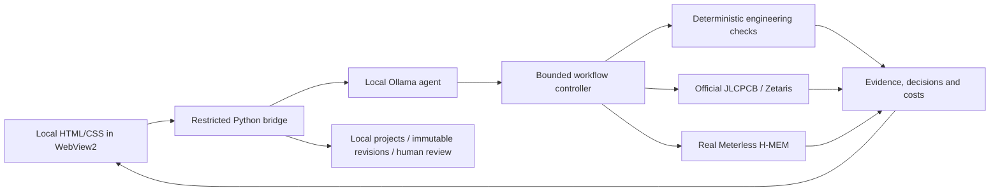

# PartLens


An electronics engineering assistant for preliminary designs and evidence-backed BOM review.
Describe an idea or import a BOM; a local LLM investigates while independent checks decide compatibility.
Missing evidence stays **unverified**. PartLens does not route boards, order components or certify hardware.

## Start the Windows app

Double-click **`dist/PartLens.exe`**. One executable contains the local HTML/CSS desktop, Python engineering
engine and real Node/H-MEM memory bridge. Python, Node and npm are not required on the user's machine.
The Windows presentation uses **pywebview + WebView2**, requiring the Windows WebView2 Runtime and .NET
Framework 4.6.2+. Chat, Settings, BOM review and Evidence share one interface; the application does not open
the earlier Tkinter workspace windows.

The conversation workspace includes saved chats, inline requirement questions, tool activity, BOM
attachments and an evidence panel. The detailed BOM workspace is available from the sidebar in the same window.
It now saves projects and immutable BOM revisions, checkpoints interrupted work, and records engineer
reviews before exporting a proposal. See [the saved project/review workflow](docs/PROJECTS.md).
Open **Settings** to select the installed local model, supplier mode, JLCPCB credentials and Zetaris
connection. Use **Import .env.local** to reuse existing authorized configuration. Credentials are encrypted
for the current Windows user and stay outside the executable. **Check services** reports actual availability.

Ollama's runtime/model files and the authorized Zetaris service remain separate installations. Paid/cloud
inference is disabled. Fresh installations start with explicitly labeled synthetic demonstration data.

See [desktop setup and build instructions](docs/DESKTOP.md) and [the web desktop migration](docs/hackathon/WEB-DESKTOP.md).
The executable is a local Windows x64 build;
it has not been published or Authenticode-signed.

## Two workflows

- **New Design from an idea:** a requirements interview, provisional choices, reference-based architecture,
  generated component roles, alternatives, supplier research, deterministic checks, costs and evidence.
- **Existing BOM:** load the demo or import a CSV, inspect parts/evidence, check replacements, compare
  quantity-dependent costs and recall prior decisions with current verification.

The owner confirms requirements through actual quoted answers. Delegation permits proposals, not invented
confirmations. Component-role equivalence, application suitability and supplier availability remain separate.
Edits invalidate dependent results; records and failures remain preserved.

## Architecture



The model requests tools and proposes investigations. It cannot assign verified status, override failed
checks, invent costs or turn its text into manufacturer evidence. Manufacturer specifications, distributor
observations and assembly classifications retain distinct provenance.

## Develop and reproduce

Source requirements: Python 3.12+ and Node 20+ for the memory bridge. Current tests: **376 passing**.
Run automated tests from CMD:

```cmd
python -m venv .venv
.venv\Scripts\python.exe -m pip install -e ".[dev,llm,desktop,desktop-build]"
.venv\Scripts\python.exe scripts\validate.py
```

For real H-MEM tests, first install the pinned bridge using [DEVELOPMENT.md](DEVELOPMENT.md). Build the
single executable with `.venv\Scripts\python.exe -X utf8 scripts\build_desktop.py`.
For source-based desktop development use `.venv\Scripts\python.exe -m partlens.desktop`.
The developer CLI and evaluation scripts remain available; historical evidence is retained in
[hackathon documentation](docs/hackathon/HACKATHON-FINALIZATION.md).

The distributable deterministic examples need no supplier credentials or model:

```cmd
.venv\Scripts\python.exe -X utf8 scripts\sample_demo.py
.venv\Scripts\python.exe -X utf8 scripts\new_design_demo.py
```

Their banners identify synthetic deterministic execution; they do not claim live inference or sponsor calls.
Build/smoke details and exclusions are in [docs/DESKTOP.md](docs/DESKTOP.md).

## Limits and evidence

Real JLCPCB reads, Zetaris queries and Meterless persistence/recall have succeeded in documented bounded
runs. Other local-model trials failed or hit repetition limits. App packaging does not remove those limits.
New designs remain preliminary: power/runtime failures, exact identities, footprints, pin assignments,
battery safety, assembly eligibility and complete costs may be unresolved. Unknown fees and ordering
semantics are not invented. No validated schematic, ERC or manufacturing-ready output is claimed.

Real supplier responses, private material, credentials, models and operational stores are not distributed.
Supplier API access is not permission to redistribute records. Cursor was not used; eligibility and final
recording/publication prerequisites remain unresolved. No hackathon submission is made by this software.

[Finalization evidence](docs/hackathon/HACKATHON-FINALIZATION.md) ·
[Demo script](docs/hackathon/DESIGN-DEMO.md) ·
[Disclosure](docs/hackathon/DISCLOSURE.md) ·
[Desktop guide](docs/DESKTOP.md)

## License

Original code and synthetic fixtures: [Apache-2.0](LICENSE), with [NOTICE](NOTICE).
The approved Easyduino RP2040 BOM retains its adjacent CERN-OHL-P-2.0 license.
[THIRD_PARTY.md](THIRD_PARTY.md) records the memory engine, bundled runtime and dependency notices.
PartLens is a standalone component; future Cirquill workflows can consume its versioned reports.
