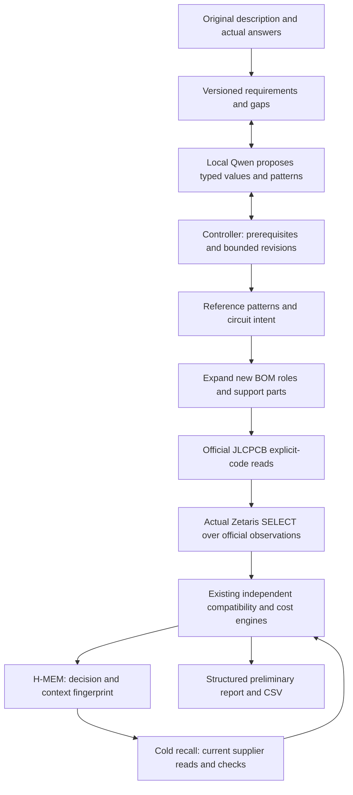

# PartLens: design from an idea

Status: working **preliminary requirements → architecture → generated role BOM** prototype. The owner
authorized this expansion after the submission freeze, and delegated unresolved choices with “use your own”
and “define your own”. Those words authorize proposals; they do not confirm any electrical specification.
The existing Easyduino workflow and its 245-test baseline remain supported. No private design was used.

## What actually works

The separate **New Design** mode accepts a product description, records typed versioned requirements,
selects from a small reference library, expands main ICs and supporting component roles into a new `Bom`,
retrieves bounded official supplier evidence, runs the existing compatibility/cost engines, and persists
decisions in real H-MEM. No BOM import occurs in this mode. **Existing BOM** retains import and optimization.

The demonstrated input was:

> Design a rechargeable smart LED badge with Bluetooth phone control, an LED matrix, NFC, microphone and IMU.

No architecture, component pairs or BOM were supplied in the evaluation prompt. The model received tool
descriptions and inspected the available patterns through a tool. The library currently offers mostly one
candidate per block; this demonstrates constrained selection, not general circuit synthesis or a broad
optimal-part search. Unsupported blocks and incomplete support roles remain visible.

The final local Qwen run selected an 8×8 monochrome display, NFC tag, sound-reactive microphone, nominal
3.3 V logic, 3.0–4.2 V battery envelope, 500 mAh capacity, six-hour target and ten-board scenario. **Every one
of these values is inferred and provisional.** They are not the owner's confirmed requirements and do not
inherit the separate Easyduino quantity of one. Size, actual cell, brightness conditions and budget remain
unanswered. Proposals enable conditional feasibility calculations while their confirmation gaps stay open.

## Implementation and control



`src/partlens/design/` contains requirements, patterns, architecture, session, strict tool registry, agent,
CLI/export, context restoration and the desktop child window. `DesignSession` extends the existing session;
it reuses catalogue adapters, `check_substitute`, application/availability checks, Decimal cost estimation,
decision memory and audited source observations. The shared agent accepts an explicit tool-name filter;
the old agent's default tool set excludes New Design operations. Source and memory implementations were
not replaced. No new runtime dependency was added.

The model can propose requirements and pattern selections, request reads and explain results. Only the
existing compatibility checker assigns role equivalence. Model text never becomes a check result, cost or
quoted owner answer. The controller renders final facts from structured results and retains the model's
draft text in the local journal. It records model versus controller actions explicitly.

Delegated runs require the applicable core proposed inputs before architecture selection. Nondelegated
runs ask up to three current decision questions per bounded invocation; they can finish incomplete with
other questions unresolved. This is a limited clarification policy, not a complete conversational product
requirements assistant. Requirement revisions invalidate the whole current circuit/BOM/qualification/cost
state conservatively; the journal, old artifacts and stored memories remain intact.

The local agent has 40 model-turn and 80 tool-attempt limits, a 300,000 cumulative token stopping threshold,
and at most two architecture proposals before required downstream operations. The token threshold is
checked between turns and can be exceeded by the final turn. Failed constraints do not prevent an honestly
incomplete role BOM. Completion of workflow operations does not mean engineering validation succeeded.
`operational_pipeline_complete` also requires observed supplier parts and persisted decisions.

## Versioned interfaces

| Schema | Content and boundary |
|---|---|
| `partlens.requirements/1` | Design ID, original description/source, feature extraction, domains, current values and append-only history. Entries include units, confirmed/inferred/optional/conflicting state, quote/source, rationale, dependencies and revision. Missing entries appear as unanswered gaps. Only quoted actual user messages can bind. |
| `partlens.patterns/1` | Limited available patterns, functions, references, reviewed-reference status and omissions. A reviewed fact is distinct from hardware validation. |
| `partlens.circuit/1` | Requirement fingerprint/revision, selected patterns/versions, available alternatives, rail and interface contracts, buses, proposed GPIO assignment, role expansion, named net intent, conditional estimates, checks and unresolved items. |
| `partlens.design-bom/1` | New generated BOM, role/block, unique reference designators, quantities, identity/package requirements and generation provenance. No imported BOM. |
| `partlens.design-report/1` | Circuit, each role's source/identity/specifications, qualification matrices, risks, missing parts, cost scenarios and memory operations. Always preliminary. |
| `partlens.design-memory/1` | Semantic requirement hash, circuit fingerprint and pattern versions, attached to actual H-MEM decisions. A context mismatch prohibits inheriting verification. |

Counts are positive whole numbers; engineering values use `Decimal` and explicit units. Supported typed
fields cover LED dimensions/type/current, NFC/microphone purpose, logic/battery voltage, capacity/runtime,
charging use, width/height, quantity, brightness and budget. Unknown dimensions, interfaces and manufacturing
constraints are not synthesized into evidence. Feature extraction is intentionally limited to the supported
vocabulary. It is not a general electronics ontology. No schema-compatibility guarantee beyond version 1 is
claimed; consumers must check the schema and preliminary flags.

Future Cirquill consumers can use `DesignSession` and the shared tools in process, or consume exported
`requirements.json`, `circuit.json`, `report.json` and `bom.csv`. CSV is a convenience view; JSON retains
the detailed check/evidence structure. No public HTTP/MCP service or CAD API is implemented in this change.

## Limited reference library

These are original, hand-authored role definitions informed by manufacturer references, not copied
schematics or hardware-tested templates. Main IC supplier leads are bounded explicit codes; leads are not
evidence. Supporting role presence is checked; many support identities and all physical implementations
still need review. Each pattern records its omissions and validation status.

| Block / pattern | Primary reference and conditional limits | Unresolved implementation |
|---|---|---|
| BLE / `ble.esp32c3_mini` | [Espressif ESP32-C3-MINI-1](https://documentation.espressif.com/esp32-c3-mini-1_datasheet_en.pdf), supply table and peripheral guidance; N4X ordering variant; 3.0–3.6 V and external supply recommendation ≥0.5 A | Module footprint, RF keepout, mux/strap/debug interactions. Proposed usable GPIO are not validated pins. |
| Power / `power.tps63031` | [TI TPS63031](https://www.ti.com/lit/ds/symlink/tps63031.pdf), Fig. 6/Table 2 and output capability; fixed 3.3 V, 1.5 µH role, input/output bypass roles. Conditional boost output up to 0.5 A for input >2.4 V | Exact inductor saturation/DCR/ripple, capacitor bias/ESR, stability, layout, thermal and peak load. The 1 A switch rating is not output capability. |
| Matrix / `led.is31fl3731` version 2 | [Lumissil IS31FL3731 Rev. G](https://www.lumissil.com/assets/pdf/core/IS31FL3731_DS.pdf), typical application and current equations: up to 144 discrete monochrome channels; 20 kΩ reference gives typical 3.2 mA average LED current | Crossplex wiring, exact LEDs, address, REXT/PWM/worst-case current. Official supplier manufacturer label ISSI is not automatically treated as Lumissil. |
| IMU / `imu.lsm6dso` | [ST LSM6DSO](https://www.st.com/resource/en/datasheet/lsm6dso.pdf), operating range and application bypass (p.34) | Exact footprint, CS/SDO/address straps, interrupt and bus timing. |
| NFC / `nfc.st25dv_tag` | [ST ST25DV04KC](https://www.st.com/resource/en/datasheet/st25dv04kc.pdf), Type 5 tag and supply requirements | Not a reader; coil, matching, antenna placement, address and RF validation unresolved. |
| Microphone / `microphone.sph0645` | Knowles SPH0645LM4H-B is an **unreviewed lead**; primary PDF retrieval failed | Supply/clock/data-format and lifecycle contract not independently established. It cannot receive a reviewed-pattern pass. |
| Charger / `charge.mcp73831` | [Microchip MCP73831 family DS20001984H](https://ww1.microchip.com/downloads/aemDocuments/documents/APID/ProductDocuments/DataSheets/MCP73831-Family-Data-Sheet-DS20001984H.pdf), p.18 application; -2 nominal 4.2 V and tolerance table p.3 | RPROG/charge rate, exact cell chemistry/tolerance/temperature and thermal conditions. No reviewed simultaneous-load power path. |
| Protection / `protection.bq29700` | [TI BQ2970](https://www.ti.com/lit/ds/symlink/bq2970.pdf), typical two-FET/filter structure | Exact protector suffix, FETs, thresholds, cell certification, current and component values. No selected purchasable implementation. |
| Debug / `debug.uart` | Espressif programming/reset/boot guidance | Connector identity/pinout, charging input, ESD/fusing; no implicit USB-C circuit or absent CC resistors assumed. |

Independent capacitor facts were reviewed on Samsung's exact product listings:
[CL05B104KO5NNNC](https://product.samsungsem.com/mlcc/CL05B104KO5NNN.do) and
[CL10A106KP8NNNC](https://product.samsungsem.com/mlcc/CL10A106KP8NNN.do). Role equivalence checks include
capacitance, voltage rating, dielectric, tolerance and package. Effective capacitance under bias, ESR,
ripple, temperature, current application and physical layout remain unverified. Same MPN with a different
manufacturer cannot inherit another manufacturer's evidence; a deterministic regression covers this.

## Observed live results

All records/artifacts below are **owner-local ignored evidence**, not redistributed supplier datasets.
Timestamps in identifiers are UTC; the final validation continued on October 23 in the owner's timezone
(October 24 UTC). No paid inference or Cursor was used. This is a development series, not a measured
general success rate. Provider metadata and actual tool I/O are retained in each JSONL journal.

| Trial | Observation |
|---|---|
| `20261023T204025Z-b3590a` | Ollama unavailable; no tool operations or BOM. Initial renderer/exit completion defect was corrected, original failure preserved. |
| `20261023T204118Z-18eb9c` | Forty turns exhausted collecting inputs and malformed-unit attempts; no BOM. Batch recording and delegated-choice control subsequently added. |
| `20261023T204345Z-2d54b3` | Generated roles but repeatedly weakened architecture. Initial token accounting read the wrong provider keys; correction record `20261023T204642Z-3f381c` reports >465k tokens already used at its snapshot. This is not a valid budgeted acceptance run. |
| `20261023T204849Z-c62ba0` | Corrected accounting: 13 tool attempts, 152,803 tokens, 35 roles. Official source read succeeded; Zetaris connection failures prevented usable qualification/memory. |
| `20261023T205617Z-2786e9` | After service recovery: 204,669 tokens; actual supplier/Zetaris/memory operations. Proposed addressable matrix incompatible with the discrete monochrome pattern, retained as failed. Earlier pattern identity handling was tightened afterward. |
| `20261023T210016Z-27083f` | Premature architecture with incomplete core assumptions. Controller subsequently required applicable proposed inputs. |
| `20261023T210418Z-b9ef65` | Full pipeline, 295,573 tokens. Later review caught 3.6 V proposed battery target versus 4.2 V charger; independent charge-setpoint and optimistic runtime checks were added. Historical outputs are not silently upgraded. |
| **`20261023T210850Z-8dbb3c`** | **Final Qwen3.5 9B trial: 12 model turns/tool attempts, 133,340 input+output tokens, 35 roles/102 placements, 13 exact sourced roles, 9 verified capacitor-role matches, 26 unverified roles, 13 actual H-MEM decision writes.** One cache hit reused genuine official observations; 16 actual Zetaris SELECTs succeeded. No new HTTP call is claimed for this model run. |

The final trial's architecture has **26 conditional passes, 12 unverified checks, two failures**. Passed
checks include reviewed support-role presence, evidenced operating voltage bounds, fixed output match,
64-channel capacity, tag function and proposed GPIO count. They do not validate pin mux or application
safety. The two failures are:

- Supply reserve: the ESP32 module's ≥0.5 A supply recommendation plus 0.192 A proposed LED average load
  exceeds the converter's conditional 0.5 A boost capability, before other loads. Reserve is not average
  MCU consumption, and this conservative screen is not a measured combined transient profile.
- Runtime: even the optimistic LED-only bound, `4.2 V × 0.5 Ah / (3.3 V × 0.192 A)`, is about 3.31 h,
  below six hours. It assumes ideal efficiency and excludes MCU/peripherals; a sufficient bound would
  remain unverified, never prove runtime. Exact cell usable energy and load profiles are missing.

The selected ICs remain application-unverified; 22 roles lack exact selected supplier identity. Official
observations include zero stock for some leads. Missing footprints, exact cell/FET/inductor/LED/connector
identities, unresolved microphone, address/timing/pin contracts, antenna tuning and thermal details prevent
a complete purchasable or manufacturing-ready BOM. Failed checks were not overridden to finish the run.

### Fresh reads and cold memory

`20261024T035021Z-e462c3` attempted fresh reads inside the network sandbox: transport failures exhausted
the bounded request budget. Five memories were actually recalled, all stayed unverified. This negative
record remains intact.

**`20261024T035121Z-f4d0ce`** repeated the authorized read-only operation with network access. One fresh
official detail POST succeeded; 32 real Zetaris SELECTs served current and revised checks. The journal
contains query SQL, HTTP status, result identifiers, response digests and client request IDs; absent
server-native IDs are not invented. Example actual query locator:
`zetaris:5c7ccb13-76d5-45f7-a3d5-721b7dd20a31`, HTTP 200, one returned component row.

A newly started Node H-MEM process read the same persisted store. Five returned memories received current
source/check operations: **four unchanged, one cannot_reverify**. The explicit hypothetical change to
32 columns invalidated current qualifications/BOM and all five prior contexts became `changed_context`.
This cold script is **controller-operated, with no model call**, not a second autonomous Qwen design trial.
Memory recall does not transfer a verification result. Only five ranked memories were recalled, not all 13.

The data layer uses actual Zetaris `WITH ... VALUES ... SELECT` over bounded official observations; this is
not a persistent new supplier catalogue, CSV export or a mocked sponsor response. No existing dataset was
overwritten. Recovery of the owner's stopped Docker deployment recreated only its unhealthy driver
container after inspection; existing volumes and datasets were retained. Recovery and smoke failures are
recorded separately (`20261023T205447Z-361d6f`, `20261023T205602Z-3b5111`).

## Cost meaning

The final generated design reports provisional ten-board and hypothetical sixty-board scenarios. The
original synthetic reference separately exercises one and sixty; the owner's Easyduino one-board scenario
remains in Existing BOM. No new quantity is described as owner confirmed.

Official native price tiers, nominal demand and stock observations are shown with source/time. Currency,
MOQ/order multiples, some assembly eligibility and complete assembly/fabrication fees remain undocumented
or unavailable. Consequently component totals and assembled totals are **incomplete (`n/a`)**, not zero.
An internal known subtotal of zero means no complete priced lines, not a free board. A default report
currency does not establish the currency of an official native price observation. No fabrication quote,
joint count, loading fee or complete PCBA price is invented. See the existing
[JLCPCB report](JLCPCB-INTEGRATION.md) and [unsent support inquiry](JLCPCB-SUPPORT-MESSAGE.md).

## Reproduce

First follow [DEVELOPMENT.md](../../DEVELOPMENT.md) for editable installation, local Ollama/Qwen, Node H-MEM
bootstrap and owner-authorized JLCPCB/Zetaris `.env.local` settings. No credentials or real run responses
are in a clean checkout. Keep paid inference and model fallback disabled.

```powershell
# Original deterministic example: no model, supplier or sponsor operation; missing sources stay unresolved.
.\.venv\Scripts\python.exe scripts/new_design_demo.py

# Genuine local model and read-only services; the only design input is the description.
.\.venv\Scripts\partlens.exe new-design --idea "Design a rechargeable smart LED badge with Bluetooth phone control, an LED matrix, NFC, microphone and IMU." --allow-proposals --unattended --jlc --zetaris

# Desktop: Existing BOM mode stays available; select New Design from an idea.
.\.venv\Scripts\partlens.exe ui --jlc --zetaris

# Owner-local cold controller check using an actual prior run, no model call.
.\.venv\Scripts\python.exe scripts/recheck_generated_design.py --run .partlens/runs/20261023T210850Z-8dbb3c.jsonl --jlc --zetaris

# Offline deterministic re-execution. This is not a fresh integration or memory operation.
.\.venv\Scripts\partlens.exe replay .partlens/runs/20261023T210850Z-8dbb3c.jsonl --recorded-sources
.\.venv\Scripts\python.exe scripts/validate.py
```

Without `--allow-proposals`, the interactive CLI requests actual missing answers; `--unattended` leaves
them unanswered. Never use `--quantity-record` to transfer the Easyduino answer into this design. New run
IDs/artifact directories are created; do not replace previous records. Cache use is explicit in the journal.
The cold-check script uses a fresh isolated cache, retains the original typed/provenance context and
exports current and hypothetical revised reports in separate directories.

Artifacts for the final model trial:
`.partlens/new-design/20261023T210850Z-8dbb3c/artifacts/{report.json,requirements.json,circuit.json,bom.csv}`.
Fresh cold outputs are under `.partlens/design-rechecks/20261024T035121Z-f4d0ce/{current,revised}`.
The no-service deterministic example run `20261024T035218Z-8bb225` is separately labeled and never presented
as a live Qwen or sponsor operation.

### Desktop verification and manual checklist

The actual existing desktop and its New Design entry were inspected visually. The new window exposes a
description box, delegation checkbox, local-agent action and requirements/architecture/BOM/checks/sourcing/
cost/explanation/audit tabs. **Full live generation and final results in that window have not been visually
accepted**; the end-to-end evidence above is CLI evidence. An unrelated desktop error dialog obscured part
of the screen and was left untouched.

Before recording a demo: open New Design, enter the original generic description, explicitly enable
provisional choices, run the local agent, inspect every tab, verify role versus application labels, inspect
failed power/runtime checks and unknown costs, check displayed record path and exported CSV/JSON, then
close during a separate trial to check cancellation. Confirm Existing BOM remains usable. Do not capture
credentials or assume cached evidence is a fresh HTTP operation.

## Actual connectivity outputs and optional CAD research

Exports contain **named net/port intent only**. Endpoint pin numbers are `null`, connections unvalidated,
and the proposed GPIO assignment is not a pin-accurate netlist. No `.kicad_sch`, electrical netlist, layout,
ERC log, symbol/footprint validation or hardware-tested design was generated.

[Official SKiDL documentation](https://devbisme.github.io/skidl/) describes netlist/ERC and schematic
generation; a local SKiDL 3.0 installation/version was not established or exercised.
[KiCad CLI documentation](https://docs.kicad.org/10.0/en/cli/cli.html) describes schematic ERC/netlist export,
but `kicad-cli` was not installed/available here. Adding either exporter before exact pin/support contracts
would not establish correctness. Export investigation did not block requirements-to-BOM delivery.

## Validation, provenance and repository separation

The full suite preserved all 245 existing tests and adds deterministic coverage for gaps/conflicts/units,
voltage and resources, missing reference/support evidence, bus collisions, unknown identity/footprint/
prices, requirement invalidation, actual H-MEM changed-context checks, provenance restoration, token
accounting, controller recall and cancellation. A test-construction failure is preserved in
`tests-20261023T204817Z-294e90.txt`, along with earlier full-suite records. Latest results are appended below.

Replays after the expansion match 104/104 historical reference operations, 21/21 M5 research operations,
11/11 final New Design operations, and 6/6 cold-session deterministic operations. Memory-dependent tools
are excluded from replay; the actual cold operation above establishes recall. Audit IDs:
`20261024T035134Z-00bba9`, `20261024T035134Z-9e1c45`, `20261024T035135Z-9a4e7d`,
`20261024T035135Z-9f8258` in `.partlens/runs/replays/`.

Final owner-local suite: **275 passed in 11.08 s**, no skips or regressions;
`.partlens/validation/tests-20261024T035603Z-ee1cd8.txt`. The prior 274-pass result remains preserved as
`tests-20261024T035058Z-81d7d0.txt` before the additional cross-manufacturer regression.
Scoped source/index audit `20261024T035716Z-17ab1c` examined 127 approved files and all 56 staged blobs:
no configured-secret matches, owner personal paths/contacts or broken documentation links. The retained
internal LCSC fixture hash remained unchanged. `git diff --check` passed; the index was not altered.
The index still represents older work and is not a staged release of this expansion.

An audited source-only copy installed offline into a separate target and proved that imports came from
that installation, then ran CLI help, both deterministic examples and the full public-copy suite:
**266 passed, nine optional H-MEM tests skipped**. No credentials, supplier records, model state or vendored
engine were copied. Record `.partlens/validation/public-copy-checks/20261024T035850Z-bb6a25.jsonl`;
its test log is `tests-20261024T035855Z-d75534.txt` inside the isolated copy. The earlier failed installation
(`20261024T035814Z-afb553`) is retained: the environment lacked the declared setuptools build backend.
Installing setuptools 84.2.1 resolved that environment prerequisite; it is not a new runtime dependency.

Working-tree whitespace checks passed. The older staged index separately reports an extra blank EOF line
in `src/partlens/session.py`; its staged contents must be refreshed/reviewed before a future signed release.
No index mutation or signing bypass was used to conceal that result.

The existing `partlens` package/CLI already has independent naming and no runtime dependency on a Cirquill
layout engine. The smallest safe repository separation is an audited source-only export of the current
package, bridge, original tests/examples, licenses and current documentation, followed by clean-install
validation and a signed initial commit; retaining full signed history instead needs an explicit reviewed
history plan. Exclude `.partlens`, credentials, SDKs, downloaded dependencies and all private material.
Do not copy the workspace root wholesale or use the old submission ZIP as this expanded release.
The original workspace/history stay intact. **No separate repository, remote, history rewrite or publication
has been created.** Destination/visibility and publication still require owner authorization.

Supported service installation remains an **editable source checkout plus Node bridge bootstrap**. The
Python-only wheel does not bundle H-MEM or resolve its repository-relative bridge location for a standalone
installation. A general wheel/service distribution needs an explicit bridge-resource/configuration plan
and its own operational check. The clean Python-only install above establishes synthetic/core behavior,
not complete wheel-based H-MEM deployment. `HMemBridge` already accepts an explicit `bridge_dir` for
embedding; the current CLI still uses its source-checkout default.

SSH signing remains enabled (`commit.gpgsign=true`, `gpg.format=ssh`). The observed Windows signing agent
is Stopped/Disabled; no commit was attempted. Owner-local unlock instructions remain in
[SUBMISSION-READINESS.md](SUBMISSION-READINESS.md). No private key/passphrase is handled by PartLens.
Cursor was not used; eligibility is unresolved. Manufacturing validation, public supplier-data permissions,
repository publication, permitted demo capture and final submission approval remain separate blockers.
