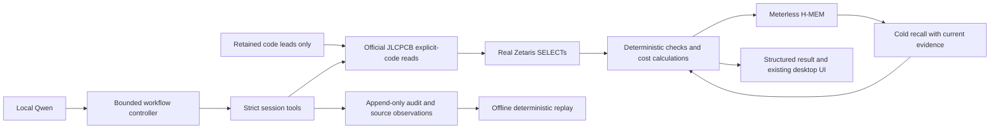

# Milestone 5: reproduce and demonstrate

Use the existing desktop application. The authentic operational evidence is internal; do not publish its
supplier records or recordings until the owner resolves data-usage permission. The distributable fallback
uses original synthetic fixtures. No Cursor, paid inference, uploads, orders or HackOS submission.

## Owner-local operational preparation

Follow [DEVELOPMENT.md](../../DEVELOPMENT.md) for the existing Python environment, pinned Node H-MEM
bridge, local Ollama `qwen3.5:9b` and existing Zetaris installation. Leave paid inference disabled and cloud
fallback off. Keep `JLC_APP_ID`, `JLC_ACCESS_KEY`, `JLC_SECRET_KEY` and Zetaris credentials in `.env.local`.
`JLC_APP_NAME` is optional. Do not print that file or place credentials in command arguments.

The following evaluation genuinely calls local Qwen and the approved read-only component API, executes
Zetaris SELECTs, writes H-MEM, closes its process, then opens a cold session and enforces fresh rechecks:

```powershell
.\.venv\Scripts\python.exe -X utf8 scripts/evaluate_milestone5.py --jlc-leads .partlens/cache/lcsc-easyduino.json --quantity-record .partlens/runs/20261022T043042Z-84edf9.jsonl --fees .partlens/fees/jlcpcb-economic-m3-20261022T071230Z-b93cfd.json
```

The retained fixture supplies code leads only; it is not redistributed or refreshed from undocumented
endpoints. The harness supplies BOM line IDs, not candidate pairs. Ceilings per session: 32 model turns,
60 tool attempts, 300,000 cumulative tokens, 12 HTTP attempts including retries and 40 distinct part codes.
Actual stock ages from its recorded retrieval time. A successful earlier run is not proof of current stock.

To inspect the actual successful model selections in the existing UI using new deterministic official
reads, without another model call:

```powershell
.\.venv\Scripts\python.exe -X utf8 scripts/preview_milestone5.py --run .partlens/runs/20261023T030853Z-988c1b.jsonl --quantity-record .partlens/runs/20261022T043042Z-84edf9.jsonl --fees .partlens/fees/jlcpcb-economic-m3-20261022T071230Z-b93cfd.json
```

This preview is labeled as deterministic rechecking of a live run. It must not be introduced as a new
autonomous run. Select a matched Parts row to inspect exact identity and evidence. Qualifications has a
status filter and separate equivalence/application columns. New session + recall performs actual H-MEM
retrieval and at most three distinct deterministic rechecks; the live evaluation enforces all five returned
memories. Cost comparison preserves owner quantity one and labels sixty hypothetical.

## Three-minute demonstration

| Time | Show and explain |
|---|---|
| 0:00–0:25 | Easyduino BOM and Requirements. Owner quantity one cites the original user message; missing electrical conditions and headers remain explicit. |
| 0:25–0:55 | Evidence. Exact manufacturer/MPN, timestamp, official endpoint and Zetaris provenance; show raw library type, classification confidence and unknown commercial terms. |
| 0:55–1:35 | Qualifications. One verified equivalence with application unverified; a 27 pF part rejected against 100 nF; an IC alternative unverified because package/pinout/function evidence is missing. Show the actual check matrix. |
| 1:35–2:00 | Sourcing and Cost. Flash stock risk; owner one versus hypothetical sixty; native nominal price intervals, unknown currency/MOQ, and no complete assembled quote or savings claim. |
| 2:00–2:35 | New session + recall. Show provenance and fresh comparisons. Historical verified text cannot promote current status. Explain that the controller enforces omitted rechecks. |
| 2:35–3:00 | Run record and architecture below. Distinguish the recorded autonomous run, current deterministic preview and offline replay. State unresolved commercial, public-data and eligibility questions. |

Do not promise a live model review completes within this narration. Preflight it, retain the complete
record, and show its results honestly. If services fail, preserve the failure and use the labeled fallback:

```powershell
.\.venv\Scripts\python.exe scripts/sample_demo.py
.\.venv\Scripts\python.exe scripts/validate.py
.\.venv\Scripts\partlens.exe replay .partlens/runs/20261023T030853Z-988c1b.jsonl --recorded-sources
```

The sample is synthetic and deterministic: no supplier, LLM or sponsor operation. Offline replay
re-executes deterministic tools from recorded source observations; it does not repeat network or memory
operations. Internal run files are required and must not be committed for public reproduction.



## Manual acceptance after changing machines

- Confirm 19 BOM rows, exact selected identity and timestamp, owner requirement source, and unmatched headers.
- Inspect all three qualification statuses and separate application scope; scroll the check evidence matrix.
- Confirm classification inference is labeled and `assemblyComponentFlag` does not set eligibility.
- Confirm both quantity scenarios and incomplete costs are visible before the detailed price evidence.
- Run a new memory session and inspect current comparisons and their run provenance.
- Open the audit tab and replay its deterministic outputs. Verify credentials are absent from recordings.

Actual native Windows visual review was performed on the owner machine; this checklist remains necessary
for other displays, service configurations and future UI changes.
