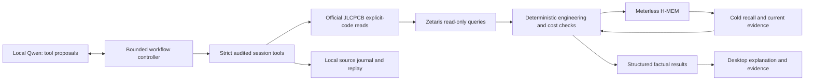

# Historical README before the unified desktop

This is an archived milestone snapshot; current launch/build instructions are in [the root README](../../README.md).

# PartLens

**An electronics engineering agent for preliminary designs, component selection and evidence-backed BOM review.**

A cheaper component is useful only if it meets the design's requirements, is available in the needed
quantity and does not introduce hidden assembly costs. PartLens investigates a BOM, retrieves supplier
evidence, runs deterministic engineering checks and retains the reasoning behind each decision.

Local Qwen chooses investigations. Independent Python checks decide qualification. Missing evidence stays
**unverified**. Original-specification equivalence and application suitability are separate conclusions.
PartLens is being prepared as a standalone product; this workspace still holds the Cirquill repository.
Future Cirquill workflows can consume its versioned reports. It does not route PCBs, edit production designs
or place orders.

## Two workflows

**New Design** turns a product description into typed requirements, a proposed architecture and a newly
generated preliminary BOM with supporting component roles. A limited manufacturer-reference library,
official supplier reads and independent checks distinguish sourced parts, verified role matches and
unresolved implementation. Delegated defaults remain provisional. No validated schematic or
manufacturing-ready circuit is claimed.

**Existing BOM** retains import, compatibility review, sourcing and cost optimization.

The original [design-generation report](../../docs/hackathon/DESIGN-GENERATION.md) documents a genuine local Qwen run:
35 generated BOM roles, 13 exact sourced roles, nine verified capacitor-role matches and 13 real H-MEM
decision writes. All circuit applications remain unverified; power and runtime checks fail. The model run
used cached official observations with 16 real Zetaris queries; a separate controller session performed
fresh supplier reads and cold memory rechecks. These are bounded observations, not a reliability claim.
The subsequent [architecture-correction milestone](../../docs/hackathon/ARCHITECTURE-CORRECTION.md) independently
investigates a higher-current converter without changing requirements and evaluates a distinct BLE
temperature monitor. The corrected badge has 39 roles and still fails runtime; the temperature design has
29 roles and unresolved evidence gates. Neither is accepted complete hardware. The owner's actual
**Monochrome** reply is confirmed separately from the other provisional values. The
[interactive-workflow milestone](../../docs/hackathon/FINAL-DESIGN-WORKFLOW.md) adds ranked clarification,
desktop edits with revalidation, unapplied runtime tradeoffs and readable sourcing risks.
Current suite: **318 passes**. See the [finalization report](../../docs/hackathon/HACKATHON-FINALIZATION.md),
[New Design demo](../../docs/hackathon/DESIGN-DEMO.md) and
[standalone checkout readiness](../../docs/hackathon/STANDALONE-READINESS.md).

That workflow milestone's desktop trial completed 12 real local Qwen turns, an official JLCPCB lookup, 21 actual
Zetaris queries and 18 H-MEM writes. Its provisional matrix/current assumptions fail both power and
runtime screens; calculated alternatives remain unapplied and application compatibility is unverified.
The report preserves earlier model-parser/service failures and separates the subsequent controller-only
owner-answer revalidation. This is a bounded demonstrated workflow, not a reliability or hardware guarantee.

Finalization additionally demonstrated a 10-turn structured-output desktop run with official JLCPCB,
21 Zetaris queries and 18 memory writes. Its 32-LED 4 × 8 proposal remains provisional and fails runtime.
Two other structured trials hit repetition limits. Tests pass, but autonomous completion and full electrical
suitability are not assured; all failures and the labeled deterministic contingency remain documented.

```powershell
# Original deterministic example; no model, supplier or sponsor operation.
.\.venv\Scripts\python.exe scripts/new_design_demo.py

# After local model, Node H-MEM and authorized services are configured:
.\.venv\Scripts\partlens.exe new-design --idea "Design a rechargeable smart LED badge with Bluetooth phone control, an LED matrix, NFC, microphone and IMU." --allow-proposals --unattended --jlc --zetaris
```

The agent exports preliminary requirements/circuit/report JSON and role BOM CSV under ignored
`.partlens/new-design/<run>/artifacts/`. Real supplier responses remain internal. The desktop's
**New Design from an idea** button opens the separate workflow. The full temperature-monitor UI workflow
and all result tabs were inspected visually; see the milestone report for evidence, limits and reproducible
source-checkout preparation. A complete assembled cost, schematic and hardware validation remain unavailable.

## Demonstrated, with limits

- BOM import and requirements with quotation/message provenance.
- Bounded local `qwen3.5:9b` tool use, without paid inference or cloud fallback.
- Authenticated official JLCPCB component reads and real Zetaris SELECTs over supplier evidence.
- Deterministic verified, rejected and unverified alternatives with identities, timestamps and check matrices.
- Quantity-dependent Decimal calculations, price intervals and sourcing risks; unknown terms stay unknown.
- Real Meterless H-MEM persistence and separate-session recall with controller-enforced current rechecks.
- Desktop UI, append-only local records and offline deterministic replay.

The [Milestone 5 report](../../docs/hackathon/MILESTONE-5.md) documents one successful official-source research
trial and one cold session: eight decisions, ten authenticated supplier requests and 88 actual Zetaris
queries. Five recalled items received fresh controller-enforced checks: three unchanged, two still lacking
evidence. This is not a general model success rate. The approved pre-expansion freeze had **245 passing
tests**; current expansion validation is recorded in the [design-generation report](../../docs/hackathon/DESIGN-GENERATION.md).

## Architecture



The model cannot mark a part verified, invent a binding requirement or price, or override a failed check.
Memory is historical context. Recorded-source replay is offline, not a fresh supplier or sponsor operation.

## Quick start: distributable synthetic demonstration

Requires **Python 3.12+**. Run from the repository root in Windows PowerShell; on macOS/Linux replace
`.venv\Scripts\python.exe` with `.venv/bin/python`. The sample needs no credentials, model, Node or services.

```powershell
python -m venv .venv
.\.venv\Scripts\python.exe -m pip install -e ".[dev]"
.\.venv\Scripts\python.exe scripts/sample_demo.py
.\.venv\Scripts\python.exe scripts/validate.py
```

The sample imports a synthetic BOM and checks verified, rejected and unverified alternatives. It prints
**SYNTHETIC DETERMINISTIC SAMPLE**. It does not call Qwen, JLCPCB, Zetaris or Meterless and is not the
owner's Easyduino build. Original synthetic fixtures are Apache-2.0. Tests requiring the optional H-MEM
engine or Anthropic SDK skip when unavailable; the 245-pass owner validation had both installed. Test logs are retained in
ignored `.partlens/validation/`.

## Local agent and services

For real operations, also install Node.js 20+, a local Ollama model/runtime, and Tkinter for the desktop.
The tested configuration used Python 3.14, Node 20 and a 65,536-token context on a 16 GB GPU. Smaller
machines may require less context and can return partial results.

Copy `.env.example` to **gitignored** `.env.local` only if it does not exist. Configure locally; never paste
credentials into commands, recordings or public issues.

| Service | Configuration |
|---|---|
| Local Qwen | `PARTLENS_LLM_PROVIDER=ollama`, `PARTLENS_LOCAL_MODEL=qwen3.5:9b`, `PARTLENS_LOCAL_URL=http://127.0.0.1:11434`; keep `PARTLENS_ALLOW_PAID_INFERENCE=disabled` and `PARTLENS_MODEL_FALLBACK=disabled` |
| Official JLCPCB | Approved component permission; `JLC_APP_ID`, `JLC_ACCESS_KEY`, `JLC_SECRET_KEY`; optional `JLC_APP_NAME`. Explicit public component-detail reads only |
| Zetaris | Owner-authorized SQL UI gateway origin in `ZETARIS_BASE_URL`, plus `ZETARIS_ORG_ID` and `ZETARIS_API_KEY`. Existing-table smoke also needs `PARTLENS_ZETARIS_PARTS_TABLE`; optional settings in `.env.example` |
| Meterless H-MEM | Pinned reference engine via the local Node bridge; setup below |

For the repository's Windows Ollama launcher, obtain the official standalone runtime, verify its published
checksum and extract it to `.partlens/local-llm/runtime/`. The launcher uses loopback, workspace-local
model storage and `OLLAMA_NO_CLOUD=1`:

```powershell
.\scripts\start_local_llm.ps1 -Pull
```

Use this launcher/runtime together; another Ollama server may use a different model store.
[DEVELOPMENT.md](../../DEVELOPMENT.md) links the official download and describes configuration.

Set up Meterless from the repository root:

```powershell
Push-Location integrations/hmem-bridge
npm ci
npm run setup
Pop-Location
.\.venv\Scripts\partlens.exe smoke-hmem
```

For all synthetic provider tests as well as the H-MEM tests, install the optional SDK and rerun validation:

```powershell
.\.venv\Scripts\python.exe -m pip install -e ".[dev,llm]"
.\.venv\Scripts\python.exe scripts/validate.py
```

This installs the SDK for mocked tests; it does not authorize or make paid inference calls.

Setup downloads the pinned third-party engine into an ignored directory. Configured supplier/data checks
perform genuine read-only operations:

```powershell
.\.venv\Scripts\partlens.exe smoke-jlc --code C1525 --refresh
.\.venv\Scripts\partlens.exe smoke-zetaris
.\.venv\Scripts\partlens.exe preflight
```

`smoke-zetaris` queries the existing configured demo table. The full `--jlc --zetaris` workflow instead
runs real SELECTs over normalized official observations; it does not silently treat the old LCSC table as
current JLCPCB data. Do not recreate datasets on an existing owner's deployment.

`preflight` attempts all four startup checks: installed local model/runtime, one fresh approved JLCPCB
component read, a demo-dataset Zetaris SELECT and an isolated H-MEM bridge operation. It exits 1 if any
service is unavailable and saves the failures. The desktop **Check services** button displays the same
results. Availability does not establish inference quality, agent recall or engineering acceptance.

Native Ollama tool calling remains the default. To explicitly evaluate the documented structured-output
transport, set `$env:PARTLENS_LOCAL_PROTOCOL='json-schema'` before launching the CLI/UI. This mode sends
JSON-schema actions through the same controller and checks; it does not use Ollama's native tool parser.
There is no automatic transport fallback. Preserve errors and use the labeled synthetic demo if a live
run fails. The bounded comparison and its limitations are in the finalization report.

Authentic end-to-end evaluation needs owner-local code leads, original quantity provenance and optional
reviewed fees that are deliberately not distributed. See the [demo runbook](../../docs/hackathon/SUBMISSION-DEMO.md),
[operational commands](../../docs/hackathon/MILESTONE-5-RUNBOOK.md) and
[official API contract report](../../docs/hackathon/JLCPCB-INTEGRATION.md).

## Explicit limitations

- Currency, MOQ, order multiples and assembly eligibility remain unknown. Nominal price arithmetic is
  not a USD purchase quote. Complete assembled cost and savings are unavailable.
- Basic/Extended mapping is labeled corroborated inference; the raw assembly flag does not prove eligibility.
- Supplier assertions remain separate from reviewed manufacturer evidence. Missing circuit conditions,
  IC pinout/function/land-pattern evidence and header identities prevent full application qualification.
- Inventory is timestamped, not guaranteed procurement. Earlier flash supply risk remains in the report.
- Real supplier snapshots, API responses, internal recordings and the owner's SDK are **not distributed**.
  Public-data/branding permission remains unresolved. API access does not imply endorsement.
- Cursor was not used, as instructed. Cursor-related eligibility remains unresolved.
- No HackOS submission, confirmed eligibility or public release is claimed.

## Evidence and licence

[Submission readiness](../../docs/hackathon/SUBMISSION-READINESS.md) ·
[Timed demo](../../docs/hackathon/SUBMISSION-DEMO.md) ·
[Presentation outline](../../docs/hackathon/SUBMISSION-PRESENTATION.md) ·
[Draft submission](../../docs/hackathon/HACKOS-DRAFT.md) ·
[Pre-existing-work disclosure](../../docs/hackathon/DISCLOSURE.md).

Original code and synthetic fixtures: [Apache-2.0](../../LICENSE), with [NOTICE](../../NOTICE).
The approved Easyduino RP2040 BOM retains its adjacent CERN-OHL-P-2.0 licence.
[THIRD_PARTY.md](../../THIRD_PARTY.md) records third-party terms. Supplier records do not inherit the code licence.
